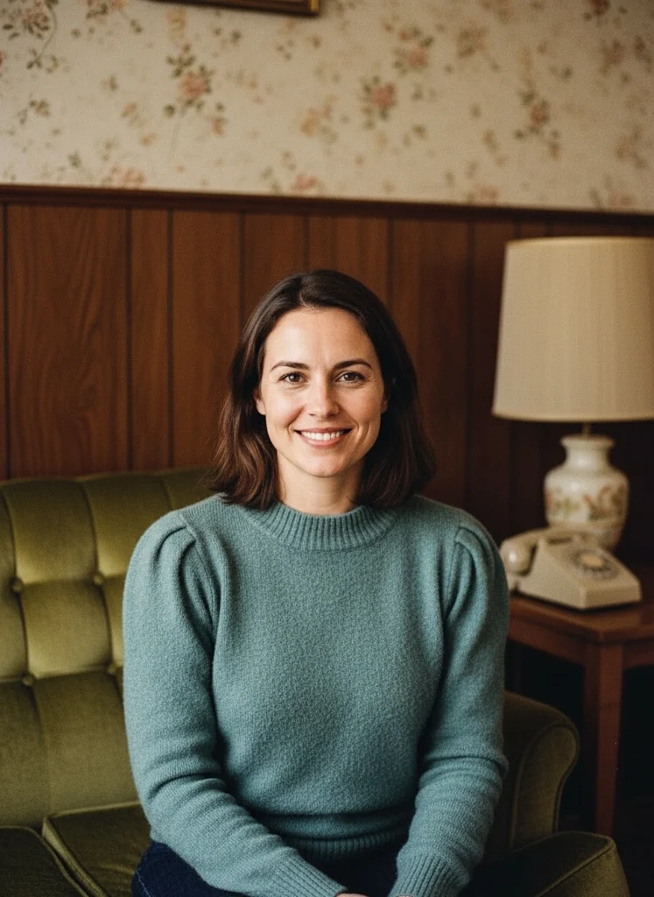
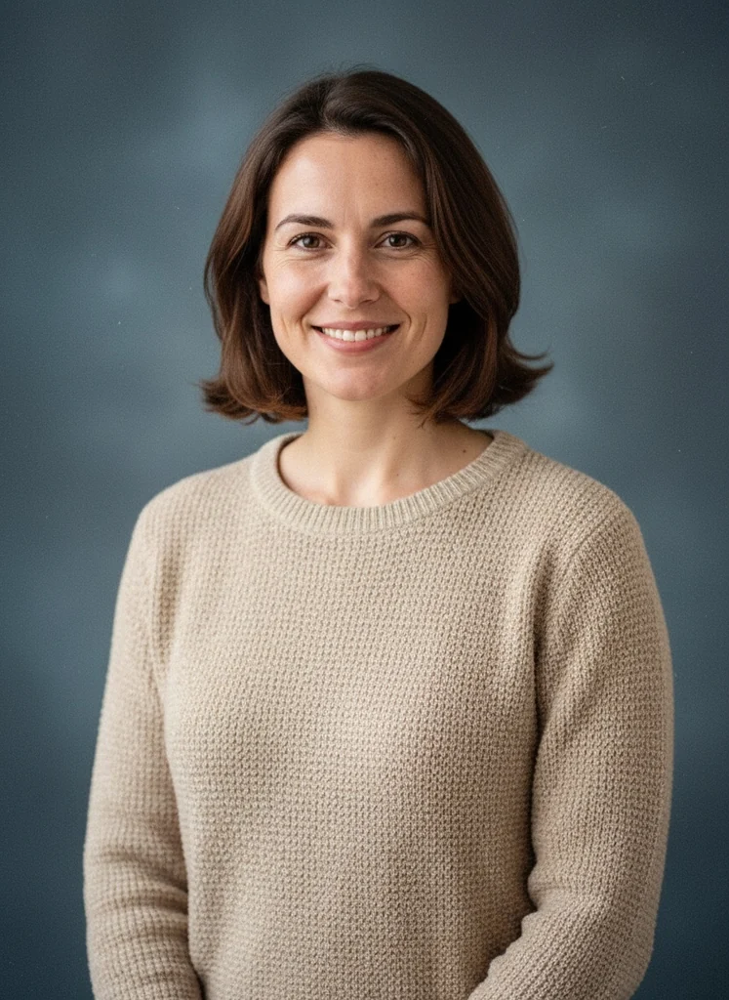
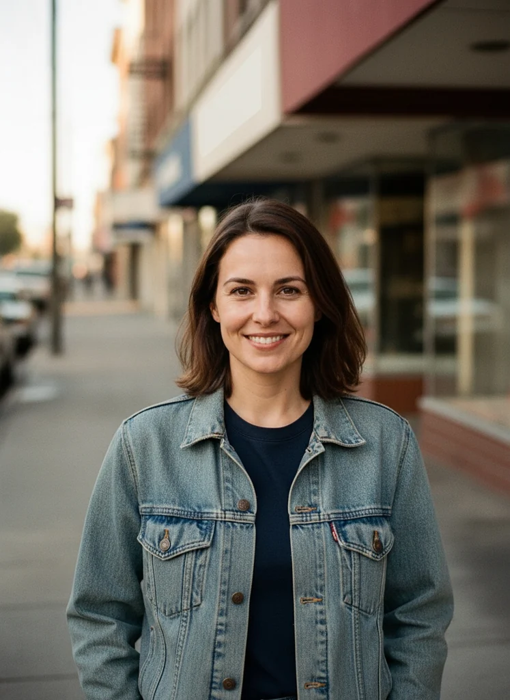

# Portrait Restyling Field Guide

A practical way to choose a source photo, compare three eighties-inspired portrait directions, and keep a result you will enjoy using. Start with the photo and its purpose; pick a tool after you know what you want to make.

## Start with a small brief

Before editing, finish this sentence: **“I want this photo to feel ___, and I will use it for ___.”**

For example, a warm birthday keepsake and a casual profile image can start from the same portrait but call for different framing. Keep the occasion in mind when you choose the mood, crop and final file.

### Source-photo checklist

- [ ] I own this photo or have permission to edit and process it.
- [ ] The face is clear enough to judge the expression and important details.
- [ ] I have kept an untouched copy of the source.
- [ ] I know where the finished picture will be used: a message, a social post or a personal collection.
- [ ] If I compare styles, I will use the same source photo each time.

A clear portrait is a useful starting point. If the face occupies only a tiny part of the image, choose a closer photo so you can make a meaningful comparison. Start with a single adult portrait when exploring the examples below; they illustrate that case.

## Choose a direction

| Direction | A useful starting point | What to look for in the result |
| --- | --- | --- |
| **Family album** | A familiar expression and a personal occasion | A warm, relaxed atmosphere that suits the person and the keepsake |
| **Studio portrait** | A picture where the face should be the main event | A clear subject, balanced framing and a portrait mood you like |
| **Street style** | A casual portrait for a playful retro post | A relaxed character and a composition that works at the intended size |

These are creative directions, rather than a test with one correct answer. A favorite selfie can work as either a studio portrait or an informal album picture. Choose the version that fits its purpose.

### Illustrated example: one source, three directions

The following are the product team's published illustrative AI-generated images of **one fictional adult**. They are examples of the three directions, not customer photographs or testimonials. The source portrait is itself AI-generated. These four images are included so readers can compare the mood without uploading a personal photo.

| Source portrait | Family album | Studio portrait | Street style |
| --- | --- | --- | --- |
|  |  |  |  |

## Compare before choosing

Use a two-pass review rather than switching rapidly between thumbnails.

**First, look at the whole image.** Does the atmosphere fit the brief? Is the face positioned well for the layout you have in mind? For a phone-sized post, inspect the result on a phone-sized preview too.

**Then, compare with the original.** Look at the expression, facial features, clothing, hands if visible, and background. Decide which details matter for this particular picture. AI restyling can change those details; a period mood does not guarantee exact identity, pose or framing preservation.

Keep the source constant when you try another style. Otherwise, you may end up comparing two different expressions instead of two visual directions.

### A quick decision sheet

Copy this into your notes for each version:

```text
Purpose:
Source filename:
Style:
Mood I want to keep:
Details I checked against the original:
Final crop / intended display size:
Saved result filename:
```

There is no need for a complicated score. A short note such as “Studio — birthday card — expression checked — portrait crop” makes it easier to find a favorite later.

## Try the workflow in a browser

[AI Photo Styler](https://aiphotostyler.com/) offers **80s Family, 80s Studio and 80s Street** presets, with a before-and-after slider and a watermarked JPEG download.

1. Choose a JPG, PNG or WebP photo that you may process.
2. Pick one of the three styles and generate a version.
3. Compare the result with your original using the slider and the checklist above.
4. Download the version you want to keep. Give it a descriptive filename, such as `birthday-studio-portrait.jpg`.
5. If you want a second direction, reuse the same source. Compare the versions in the layout where you plan to share them.

The current free beta does not require an account and has a limited daily allowance, including shared-network and site-wide limits. Recent results and favorites stay in the current browser when browser storage is available; the latest ten results are kept there. Download the images you want to retain instead of relying on browser history as your only copy.

Photos are processed by external AI and safety-checking providers. Read the product's privacy information before uploading personal photos. The checklist can also be used with another editor that provides an appropriate workflow.

## Keep a small, useful collection

Create one folder for the occasion. Put the untouched source and your chosen download together, and use filenames that describe the purpose and style. When comparing versions, open the downloaded files rather than relying only on small preview images.

A small set with a clear purpose is easier to revisit than a long stream of unnamed variations. Keep the mood you like, preserve the original, and save the result in the place you actually use.

---

**Maintainer:** Ethan Lee, working on AI Photo Styler. This guide is maintained by the team behind the tool.

**Example provenance:** The four WebP images are the product's previously published illustrative assets. The source is an AI-generated fictional adult; the three styled images were generated from that source. These are examples, not customer photos.
