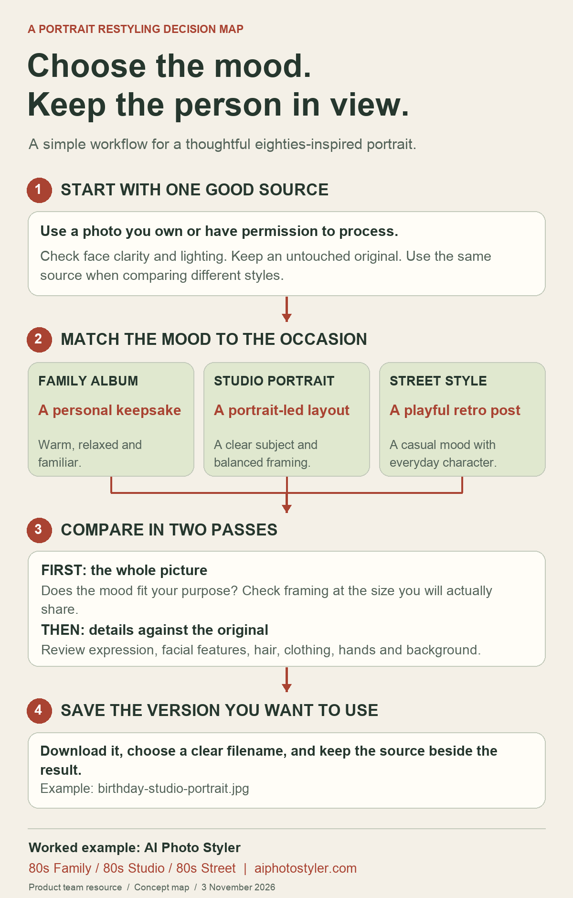

# A portrait restyling decision map

Choose the mood. Keep the person in view.

This visual guide is a resource from the AI Photo Styler team. It turns a portrait-restyling brief into four practical decisions: choose a suitable source, match a mood to the occasion, compare the result, and save a useful file.

## How to use the map

Start by finishing one sentence: “I want this picture to feel ___, and I will use it for ___.” A family keepsake, a portrait-led birthday card and a playful retro post can use the same source while calling for different visual directions.

Keep the source photo constant when you compare styles. First check the overall mood and framing at the size where you plan to share the picture. Then compare the result with the original, including the expression, facial features, hair, clothing, hands and background. The map is an editorial workflow, not a research chart or an accuracy benchmark.

The worked example uses the **80s Family**, **80s Studio** and **80s Street** options in [AI Photo Styler](https://aiphotostyler.com/). The browser tool provides a before-and-after slider and a watermarked JPEG download. Keep an untouched original beside the version you download, and give the result a name that includes its purpose and mood.

Use photographs you own or have permission to process. This diagram contains no customer photos, personal data or external research statistics.

**Created by the product team, 3 November 2026.** The product relationship is disclosed; this is a practical guide rather than an independent customer review.
